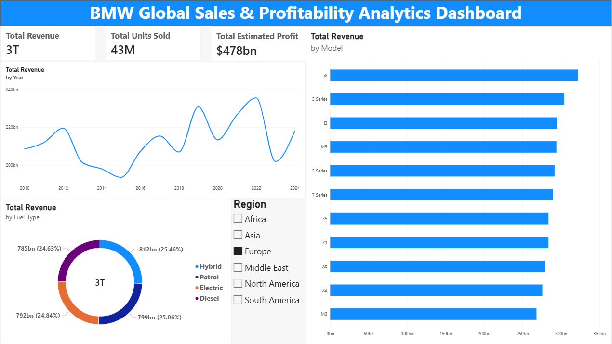

## 🚗 BMW Global Sales & Profitability Analytics Dashboard
An executive-level Business Intelligence & Data Analytics solution built using Azure Blob Storage, Python, DAX, and Power BI to ingest, process, and analyze multi-year global sales performance, profit margins, regional market share, and fuel type shifts (2010–2024).

---

## 📊 Executive Dashboard Preview

## 📊 Executive Dashboard Live Demo

---

## 💡 Key Business Questions Addressed
- **Top Revenue Drivers:** Which vehicle models generate the highest revenue and volume globally?
- **Financial Performance:** What is the overall estimated profit margin across regional markets?
- **Fuel Type Shift:** How are sales distributed across Electric, Hybrid, Petrol, and Diesel powertrains?
- **Macro Trends:** How have annual revenues trended across economic cycles from 2010 to 2024?

---

⚙️ Tech Stack & Methodology
* Cloud Data Ingestion: Azure Blob Storage hosted raw dataset (BMW sales data (2010-2024).csv), securely accessed via Python.
* ETL Pipeline: etl_pipeline.py fetches raw data from the Azure cloud container, handling nulls, type conversions, and schema standardization to produce cleaned_bmw_sales_data.csv.
* Data Modeling & DAX: Star schema modeling in Power BI with optimized DAX calculations for aggregations and profit metrics.
* Data Visualization: Executive dashboard layout featuring custom KPI callouts ($3T Revenue, 43M Units, $478.21B Profit), yearly trend lines, regional slicers, and fuel-type breakdowns.
---

## 📈 Key DAX Measures

### 1. Total Revenue
Total Revenue = SUM(cleaned_bmw_sales_data[Price_USD]) * SUM(cleaned_bmw_sales_data[Sales_Volume])

### 2. Total Units Sold
Total Units Sold = SUM(cleaned_bmw_sales_data[Sales_Volume])

### 3. Total Estimated Profit
Total Estimated Profit = 
DIVIDE(
    SUMX(cleaned_bmw_sales_data, cleaned_bmw_sales_data[Estimated_Profit_USD] * cleaned_bmw_sales_data[Sales_Volume]),
    1000000000
)

---

## 🚀 Key Business Insights
1. **Model Performance:** High-tier series (such as the i8, 3 Series, and 5 Series) consistently lead revenue contribution across global markets.
2. **Balanced Energy Portfolio:** Revenue is evenly split (~25% each) across Electric, Hybrid, Petrol, and Diesel powertrains.
3. **Regional Profitability:** Slicing by region isolates profit margin performance across North America, Europe, Asia, Africa, and Middle East territories.

---

## 🛠️ How to Run This Project
1. **Clone the Repository:**
git clone [https://github.com/johnathanajit007-afk/BMW-Global-Sales-Analytics.git](https://github.com/johnathanajit007-afk/BMW-Global-Sales-Analytics.git)

2. **Run ETL Pipeline (Optional):**
python scripts/etl_pipeline.py

3. **Open Dashboard:**
Open `dashboard/BMW_Global_Sales_Analytics_Dashboard.pbix` in Power BI Desktop.
